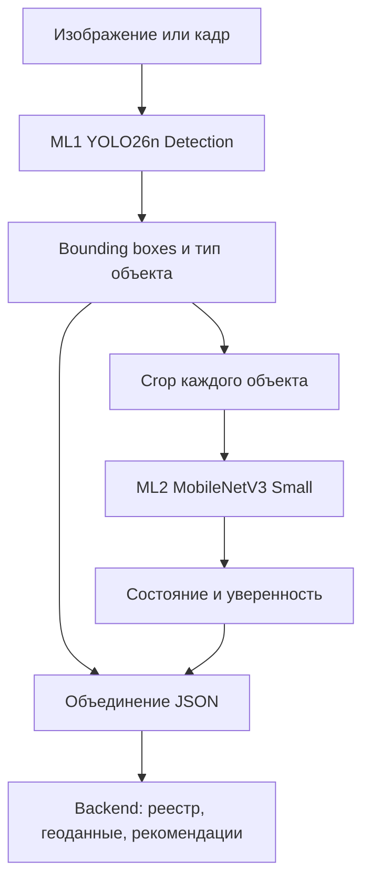

# МГТС — контекст проекта ML1 + ML2

Документ для передачи в Codex, новый чат или другому разработчику. Состояние на 26.11.2026. Это описание текущего проекта и план дальнейшей работы, а не утверждение, что все перечисленные модули уже реализованы.

## 1. Задача и границы проекта

Хакатон МГТС, направление «Сетевая инфраструктура и сервис». Требуется работающий прототип автоматического мониторинга городской инфраструктуры: обнаружение объектов на изображениях/кадрах, оценка состояния, формирование перечня объектов для проверки или ремонта, геопривязка при наличии соответствующих данных. На финале необходима демонстрация на тестовых данных, отчёт или интерфейс и объяснение архитектуры и масштабирования на камеры служебных автомобилей.

ML1 отвечает за обнаружение и тип объекта, ML2 — за классификацию его состояния. Backend отвечает за API, БД, реестр, геоданные и интерфейс. Не определять принадлежность объекта МГТС или координаты по фотографии без соответствующих исходных данных.

Изначально рассматривались люки (`access_cover`) и опоры (`pole`), но предоставленные организаторами данные относятся к ТКШ и РЩ. Приоритет — фактически предоставленный датасет. Не смешивать его со старым экспериментальным датасетом. Уточнить у организаторов, требуется ли дополнительно поддерживать люки и опоры.

## 2. Среда и принятые решения

- Windows, VS Code, PowerShell; корень `D:\mgts-ml1-clean`, окружение `.venv`.
- Старый проект `D:\mgts-ml1` не изменять. Старый `best.pt` не переносить.
- GPU GTX 1650, 4 GB VRAM; CUDA в PyTorch проверена, устройство `0` работает.
- Python 3.12.0rc3, torch 2.5.1+cu118, torchvision 0.20.1+cu118, ultralytics 8.4.218, OpenCV 5.1.0, NumPy 2.5.4.
- Зависимости: ultralytics, opencv-python, Pillow, PyYAML, numpy, pydantic, pytest. Добавить openpyxl для Excel (установка пока не подтверждена).
- ML1: YOLO26n, официальные pretrained-веса `weights/pretrained/yolo26n.pt`, дообучение только на данных МГТС. Проверить допустимость внешних pretrained-весов по правилам конкурса.
- ML2: предложен MobileNetV3 Small с ImageNet pretrained-весами и transfer learning. Выбор предварительный, обучение не начато.
- Не переустанавливать работающий PyTorch/CUDA и не обновлять драйвер без необходимости. Lock-файл с cu118 может потребовать отдельной инструкции установки на другой машине.

## 3. Что уже работает

| Файл | Назначение | Статус |
|---|---|---|
| `src/config_loader.py` | Загрузка четырёх YAML-конфигов | Проверен |
| `src/validator.py` | Проверка значений конфигурации | Проверен |
| `src/detector.py` | Загрузка YOLO, выбор GPU/CPU, inference, xyxy | Проверен |
| `src/predictor.py` | Формирование JSON-контракта ML1 | Проверен |
| `src/serializer.py` | Сохранение JSON | Проверен |
| `src/batch_processor.py` | Обработка папки с одной загрузкой модели | Проверен |
| `tests/test_config.py` | Предложены три теста конфигурации | Создание/запуск не подтверждены |

Последний подтверждённый запуск:

```powershell
python -c "from src.batch_processor import BatchProcessor; processor = BatchProcessor(); results = processor.process_directory('data/samples/batch'); print('\nSUMMARY:', results)"
```

Результат: GPU 0, `test.jpg` — 8 обнаружений, `ton.jpg` — 7, total=2, processed=2, failed=0. Файлы `outputs/json/test.json` и `ton.json` созданы. Это проверка инфраструктуры inference на COCO pretrained-весах, **не проверка качества детекции ТКШ/РЩ**. BatchProcessor пока не рекурсивен; одинаковые stem файлов могут приводить к перезаписи JSON.

## 4. Официальные данные

Источники: `doc-1795639713.docx` (ТЗ), `doc-1795639569.zip`, `doc-1795639519(1).zip`. В обоих архивах общий корень `Датасет-ДСС/`. Состав архивов проверен по спискам файлов.

| Категория папки | ТКШ | РЩ |
|---|---:|---:|
| Удовлетворительное состояние | 10 | 10 |
| Неудовлетворительное состояние ЛКП | 10 | 10 |
| МП | 10 | 11 |
| Всего | 30 | 31 |

61 фотография в категорийных папках, плюс `Фото.1.jpg` в корне (62 изображения всего), шесть XLSX и текстовый перечень сокращений. ТКШ — телекоммуникационный климатический шкаф; РЩ — распределительный щит; МП — механические повреждения; ЛКП — лакокрасочное покрытие. Excel содержит имена файлов, статусы и описания по предыдущему анализу; точные заголовки, соответствие строк фотографиям и возможные пропуски необходимо проверить скриптом. Готовых YOLO TXT-разметок в архивах не обнаружено (текстовый файл — перечень сокращений).

```text
data/raw/Датасет-ДСС/
├── МП. ТКШ/
├── МП.РЩ/
├── Неудовлетворительное состояние ЛКП. РЩ/
├── Неудовлетворительное состояние ЛКП. ТКШ/
├── Удовлетворительное состояние РЩ/
├── Удовлетворительное состояние ТКШ/
├── Перечень сокращений и условных обозначений..txt
└── Фото.1.jpg
```

Оригиналы не переименовывать и не редактировать. Фактическая структура на ПК ещё не подтверждена. Координаты объектов, уникальные идентификаторы и отдельный тестовый набор не подтверждены. Не считать числовое имя фотографии уникальным ID физического объекта без проверки.

## 5. Целевая архитектура



ML1: предложенное отображение `0: tksh`, `1: rsh`. ML2: `normal`, `coating_damage`, `mechanical_damage`. Числовые ID классификатора фиксировать по фактическому class_to_idx и сохранять вместе с весами; не полагаться на порядок папок. Две категории повреждений отображаются в общий статус `damaged`, нормальная — `normal`. При низкой уверенности предусмотреть ручную проверку, а не гарантировать исправность. Механические повреждения могут сочетаться с ЛКП; на MVP предлагается основная категория, multilabel — возможное развитие. Порог уверенности определить на validation, не придумывать заранее.

## 6. Контракт ML1 и предлагаемое расширение

Существующий контракт сохраняется; вложенный `classification` — предлагаемое расширение для согласования с backend. Пример, не реальный inference:

```json
{
  "image_id": "26224137",
  "image_width": 1920,
  "image_height": 1080,
  "detections": [
    {
      "box_xyxy": [312, 120, 780, 640],
      "score": 0.94,
      "detector_class": "tksh",
      "classification": {
        "class": "mechanical_damage",
        "score": 0.91,
        "status": "damaged",
        "requires_inspection": true
      }
    }
  ]
}
```

`box_xyxy` — абсолютные пиксели исходного изображения, начало координат слева сверху. Ultralytics уже возвращает xyxy в исходном масштабе. При отсутствии объектов `detections: []`. Confidence детектора и классификатора — разные величины. Crop ограничивать границами изображения, проверять пустые области. Ошибку ML2 не выдавать за normal. Геоданные добавлять только из проверенного источника.

## 7. Конфигурация и структура

Текущие YAML: `config/config.yaml`, `classes.yaml`, `inference.yaml`, `training.yaml`. В classes.yaml пока старые классы access_cover/pole. Изменить после проверки датасета. Текущие параметры training: pretrained=true, model=yolo26n.pt, image_size=640, epochs=100, batch_size=4, patience=20, workers=2, device=0, seed=42, project=runs, experiment_name=mgts_yolo26n. Inference: image_size=640, confidence_threshold=0.25, iou_threshold=0.7, max_detections=300, device=auto, half=false. Это стартовые параметры, не оптимизированные под новые данные. Проверить, что конфиги действительно используются при запуске, а не только загружаются валидатором.

Целевая структура (новые файлы пока только запланированы):

```text
mgts-ml1-clean/
├── config/ (config.yaml, classes.yaml, inference.yaml, training.yaml, classification.yaml)
├── data/
│   ├── raw/
│   ├── annotations/
│   ├── processed/ (detection/, classification/)
│   └── samples/batch/
├── src/
│   ├── config_loader.py, validator.py
│   ├── detector.py, predictor.py, serializer.py, batch_processor.py
│   └── cropper.py, classifier.py, pipeline.py, visualizer.py
├── scripts/
│   ├── inspect_dataset.py
│   ├── prepare_detection.py, prepare_classification.py
│   ├── train_detector.py, train_classifier.py
│   └── evaluate.py, predict.py
├── weights/ (pretrained/, trained/detection/, trained/classification/)
├── outputs/ (json/, predictions/, visualizations/, crops/, reports/)
├── tests/
├── runs/
├── .gitignore
├── requirements.txt
├── requirements-lock.txt
├── README.md
└── AGENTS.md
```

Не добавлять в Git оригинальные данные, веса, .venv, кэши и результаты обучения. Проверить .gitignore и сохранить необходимые пустые папки через .gitkeep. Не удалять существующие рабочие файлы.

## 8. План реализации и контроль качества

1. Распаковать данные, установить openpyxl, подтвердить структуру.
2. Создать `scripts/inspect_dataset.py`: рекурсивный поиск изображений/XLSX, сопоставление имён (включая числовые значения Excel), проверка читаемости, пропусков, дубликатов и конфликтов разметки. Сохранить manifest CSV с путём, ID изображения, типом, исходным статусом/описанием, нормализованной категорией и группой физического объекта при наличии. Отдельно вывести неразмеченные изображения.
3. Проверить повторяющиеся/похожие фотографии и определить группы физических объектов. Сделать общий воспроизводимый split для обеих моделей по группам, не допускать утечки между train/val/test. При малом числе объектов рассмотреть grouped cross-validation; отдельный тест организаторов не использовать для подбора параметров.
4. Разметить bounding boxes ТКШ/РЩ вручную или с проверяемой полуавтоматической помощью. Не считать целый кадр истинным bbox без проверки. Подготовить YOLO dataset.yaml и структуру images/labels. Проверить координаты, ID классов, полноту разметки.
5. Подготовить ML2 на crops размеченных объектов с тем же split. Не присваивать всем объектам в кадре общий статус без подтверждения. Аугментации только на train, сохранять признаки дефектов.
6. Обучить YOLO26n и классификатор через transfer learning; на 4 GB VRAM начать с малого batch, корректировать при OOM. Сохранить лучшие веса, конфиги, mapping классов и метрики. ML2 можно начинать параллельно после появления проверенных crops.
7. Оценить ML1 (precision, recall, mAP50, mAP50-95), ML2 (macro F1, precision/recall по классам, confusion matrix, отдельно recall повреждений), затем весь каскад на отложенных кадрах. Маленькая выборка ограничивает достоверность метрик; не обещать высокую точность.
8. Объединить ML1 + ML2, добавить визуализацию, CLI, отчёт, обработку ошибок и тесты; согласовать JSON с backend. Подготовить README/AGENTS.md и демонстрацию.

## 9. Точная точка продолжения

Пользователю предложены следующие команды; выполнение пока не подтверждено. Из корня проекта с активированной .venv:

```powershell
New-Item -ItemType Directory -Force -Path @(
    "data/annotations", "data/processed/detection", "data/processed/classification",
    "weights/trained/detection", "weights/trained/classification",
    "outputs/crops", "outputs/reports"
)
python -m pip install openpyxl
if (-not (Select-String -Path requirements.txt -Pattern "^openpyxl$" -Quiet)) {
    Add-Content requirements.txt "openpyxl"
}
python -m pip freeze | Set-Content -Encoding UTF8 requirements-lock.txt
tree .\data\raw /A
```

Перед последней командой распаковать оба архива в `D:\mgts-ml1-clean\data\raw\`, объединив общий корень. Следующий шаг — получить фактический вывод tree, проверить XLSX и реализовать inspect_dataset.py. Не начинать обучение до проверки данных и split.

## 10. Правила работы с проектом для Codex/ассистента

- Сначала изучить существующий репозиторий и этот контекст, проверить реальные файлы; не создавать заново уже существующие модули.
- Сохранять рабочую архитектуру и обратную совместимость JSON. Изменения классов и схемы согласовывать.
- Не использовать старые датасеты/веса и не трогать старый проект. Не отправлять данные МГТС во внешние сервисы без разрешения.
- Работать пошагово: назвать файл, дать полный код или конкретное изменение, команду PowerShell для проверки и дождаться результата. Объяснять назначение модулей кратко.
- Не выдавать планы за выполненную работу, синтетические примеры за реальные метрики, COCO inference за обученную модель МГТС.
- Приоритет финала — проверенный end-to-end MVP, затем улучшение качества. Архитектурные предложения (MobileNetV3, три категории состояния, расширенный JSON) пока не являются окончательно утверждёнными требованиями организаторов.
